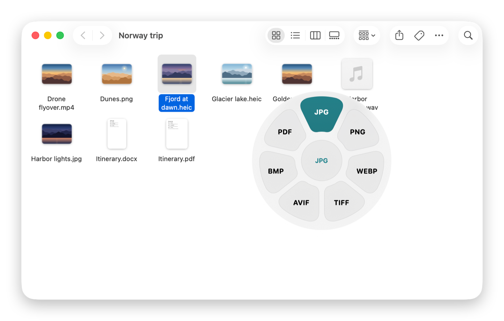
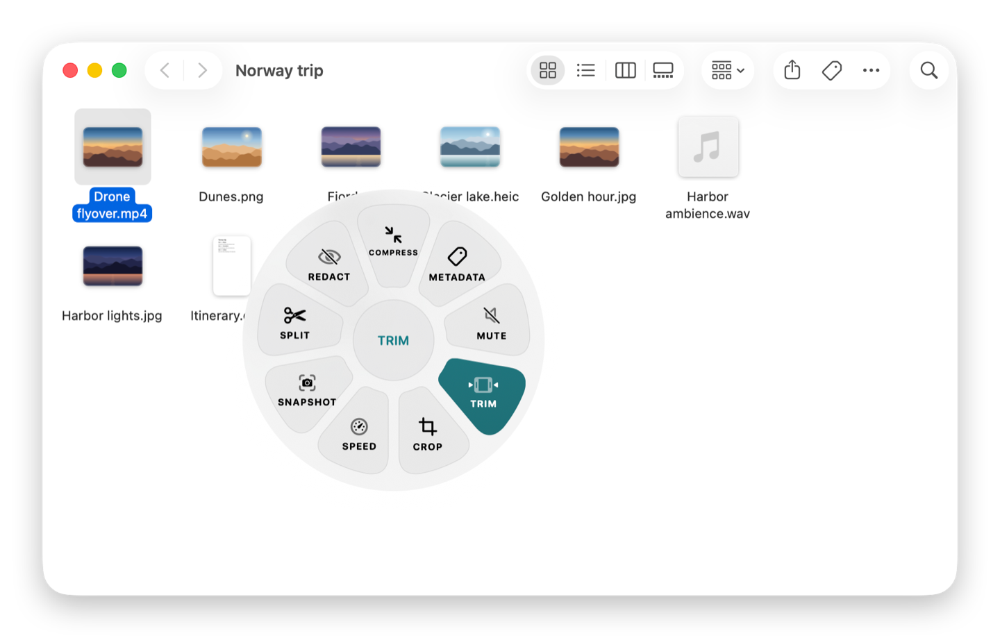
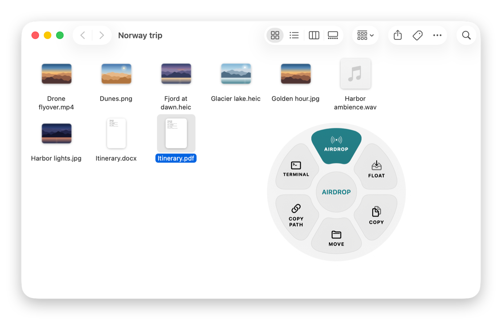

<p align="center">
  
</p>

<h1 align="center">Dropwheel</h1>

<p align="center">
  <b>Convert, edit and share files without leaving the drag.</b><br>
  Start dragging a file, tap a key, and drop it on the format you need.
</p>

<p align="center">
  <a href="https://github.com/anvarkhamidov/dropwheel/releases/latest"></a>
  <a href="https://github.com/anvarkhamidov/dropwheel/releases"></a>
  
  
  <a href="LICENSE"></a>
</p>

<p align="center">
  <a href="https://github.com/anvarkhamidov/dropwheel/releases/latest/download/Dropwheel.dmg"><b>⬇ Download Dropwheel for macOS</b></a>
</p>

<p align="center">
  
</p>

## Why Dropwheel

Converting a file on a Mac usually means opening an app, finding the export dialog, picking a format and a folder. Dropwheel turns that into one gesture: the wheel appears right under your cursor while you drag, and the result lands next to the original. No windows to open, no uploads, nothing to configure.

## How it works

1. Start dragging any file — from Finder, the desktop or another app.
2. Tap a modifier key. A wheel opens around the cursor:

   | Key | Wheel | What it offers |
   | --- | --- | --- |
   | <kbd>⇧ Shift</kbd> | **Formats** | What to turn the file into |
   | <kbd>⌘ Command</kbd> | **Tools** | Compress, crop, trim, edit and more |
   | <kbd>⌃ Control</kbd> | **Actions** | Where the file should go |

3. Drop the file on a button. That's it — the result appears next to the source file.

Missed the key? Press <kbd>Esc</kbd> or drop outside the wheel to cancel. The keys can be changed in Settings, and every wheel is also available from the Finder context menu (**Services → Dropwheel**) and from the menu bar.

<table>
  <tr>
    <td></td>
    <td></td>
  </tr>
  <tr>
    <td align="center"><sub>Tools for a video</sub></td>
    <td align="center"><sub>Actions for a PDF</sub></td>
  </tr>
</table>

## Features

**Formats**

| Kind | Converts to |
| --- | --- |
| Images | PNG, JPG, HEIC, WebP, AVIF, TIFF, GIF, BMP, PDF |
| Documents | PDF, DOCX, Markdown, HTML, TXT, EPUB |
| Spreadsheets | CSV, XLSX, ODS |
| Audio | MP3, M4A, WAV, FLAC |
| Video | MP4, MOV, GIF |

Pages, Keynote and Numbers files are supported when those apps are installed.

**Tools**

- **Images** — compress, crop, edit, annotate, add a background, redact, view and edit metadata, read QR codes, make a collage or a PDF from several images.
- **PDF** — merge, split, reorder pages.
- **Video** — trim, split, join, crop, change speed, mute, redact, grab a snapshot.
- **Audio** — trim, normalize loudness, bleep, change channels, render a waveform video.
- **Archives** — compress to GZIP, extract archives.

**Actions**

AirDrop, copy, move, copy path, open in Terminal, and a floating shelf that holds files while you switch windows.

**Built for daily use**

- Results never overwrite anything: Dropwheel picks a free name next to the original.
- Long jobs show progress and can be cancelled.
- For audio and video, the exact `ffmpeg` command is one click away, so you can tweak it and rerun it in Terminal.
- Everything runs locally. The only network request is the daily update check.

## Installation

1. [Download Dropwheel.dmg](https://github.com/anvarkhamidov/dropwheel/releases/latest/download/Dropwheel.dmg).
2. Drag **Dropwheel** to **Applications** and open it. The icon appears in the menu bar.

Audio and video need [ffmpeg](https://ffmpeg.org); writing WebP needs `cwebp`. Install both with [Homebrew](https://brew.sh):

```bash
brew install ffmpeg webp
```

Images, PDFs and documents work without them. Settings shows which tools were found and lets you point to a custom `ffmpeg`.

**Requirements:** macOS 14 Sonoma or later, Apple Silicon or Intel. The interface is currently in Russian.

## Updates

Dropwheel checks for a new version once a day and installs it on its own when no job is running — the app restarts in about a second. You can turn this off or check manually in **Settings → Updates**. Updates are delivered through [Sparkle](https://sparkle-project.org) from this repository's [releases](https://github.com/anvarkhamidov/dropwheel/releases) and are verified with an EdDSA signature.

## Building from source

Requirements: Xcode 26 or later and [XcodeGen](https://github.com/yonaskolb/XcodeGen).

```bash
git clone https://github.com/anvarkhamidov/dropwheel.git
cd dropwheel
xcodegen generate
open Dropwheel.xcodeproj
```

Run the `Dropwheel` scheme. Debug builds are signed to run locally and never check for updates.

Run the tests:

```bash
swift test --package-path DropwheelCore
```

### Project layout

| Path | What's inside |
| --- | --- |
| `Dropwheel/` | The app: drag detection, the wheel, tool windows, settings, updates |
| `DropwheelCore/` | Conversion engines and file handling as a Swift package, covered by unit tests |
| `scripts/release.sh` | Release pipeline: universal build, Developer ID signing, notarization, DMG, Sparkle appcast, GitHub release |
| `project.yml` | XcodeGen project definition |

## Contributing

Bug reports and pull requests are welcome. For anything larger than a small fix, please [open an issue](https://github.com/anvarkhamidov/dropwheel/issues) first so we can agree on the approach. Before sending a pull request, make sure `swift test --package-path DropwheelCore` passes.

## License

Dropwheel is released under the [MIT License](LICENSE).
