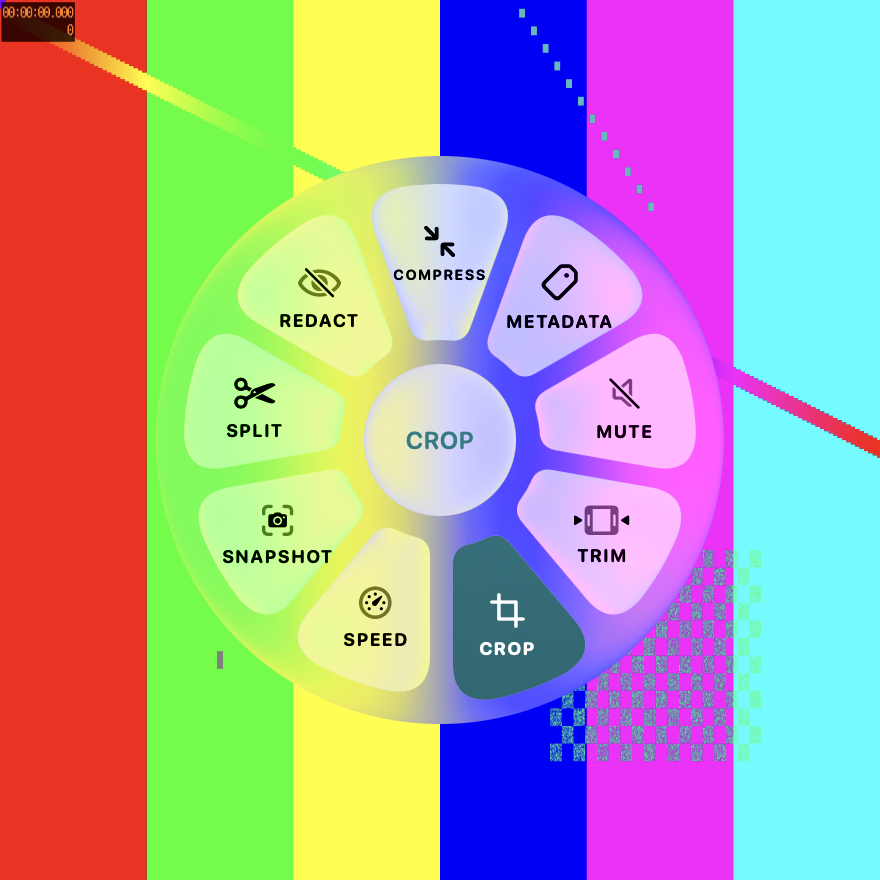
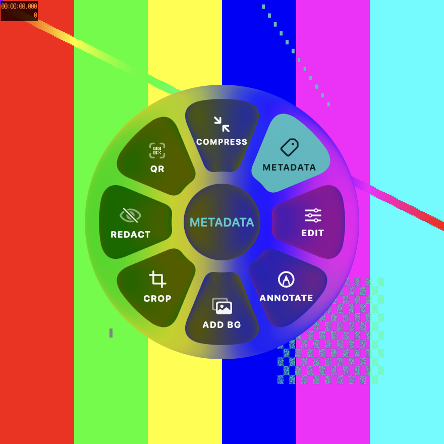

<p align="center">
  
</p>

<h1 align="center">Dropwheel</h1>

<p align="center">
  Конвертер файлов колесом для macOS: начните тянуть файл, нажмите Shift и отпустите его на нужном формате.
</p>

<p align="center">
  <a href="https://github.com/anvarkhamidov/dropwheel/releases/latest/download/Dropwheel.dmg"><b>Скачать для macOS</b></a>
  · macOS 14+ · Apple Silicon и Intel · подписано и нотаризовано
</p>

<p align="center">
  
  
</p>

## Как это работает

1. Начните перетаскивать файл из Finder, с рабочего стола или из любого приложения.
2. Коротко нажмите клавишу — у курсора появится колесо:
   - **Shift** — форматы: во что превратить файл;
   - **Command** — инструменты: сжать, обрезать, поправить;
   - **Control** — действия: куда отправить.
3. Отпустите файл на нужной кнопке. Результат появится рядом с исходным файлом.

Клавиши меняются в настройках. Колесо открывается и из контекстного меню Finder («Службы → Dropwheel»), и из строки меню.

## Что умеет

**Форматы.** Картинки: PNG, JPG, HEIC, WebP, TIFF, GIF, BMP. Документы: PDF, DOCX, Markdown, HTML, TXT, EPUB. Таблицы: CSV, XLSX, ODS. Аудио: MP3, M4A, WAV, FLAC. Видео: MP4, MOV, GIF. Pages, Keynote и Numbers тоже открываются, если эти приложения установлены.

**Инструменты.** Сжатие, кроп, правка и аннотации, фон для картинки, скрытие фрагментов, метаданные, QR-коды, коллаж и PDF из нескольких картинок, объединение и разделение PDF. Для аудио и видео — обрезка, склейка, скорость, кадр из видео, без звука, нормализация громкости, визуализация звука.

**Действия.** AirDrop, копирование пути, перенос, открытие в терминале, «полка» для временного хранения файлов.

Каждая задача показывает прогресс, её можно отменить, а точную команду ffmpeg — скопировать и повторить в терминале.

## Установка

Скачайте [Dropwheel.dmg](https://github.com/anvarkhamidov/dropwheel/releases/latest/download/Dropwheel.dmg), перетащите приложение в «Программы» и запустите. Иконка появится в строке меню.

Для аудио и видео нужен [ffmpeg](https://ffmpeg.org), для записи WebP — `cwebp`:

```bash
brew install ffmpeg webp
```

Картинки, PDF и документы работают без них.

## Обновления

Раз в день Dropwheel проверяет новую версию и ставит её сам, когда не занят конвертацией: приложение перезапускается за секунду. Отключить можно в настройках, там же — кнопка «Проверить сейчас». Обновления подписаны ключом EdDSA и приходят через [Sparkle](https://sparkle-project.org) из [релизов этого репозитория](https://github.com/anvarkhamidov/dropwheel/releases).

## Сборка из исходников

Нужны Xcode 26+ и [XcodeGen](https://github.com/yonaskolb/XcodeGen).

```bash
xcodegen generate
open Dropwheel.xcodeproj
```

Логика конвертации — в пакете `DropwheelCore`, тесты: `swift test --package-path DropwheelCore`. Релиз (подпись Developer ID, нотаризация, DMG, лента обновлений) — `scripts/release.sh`.
